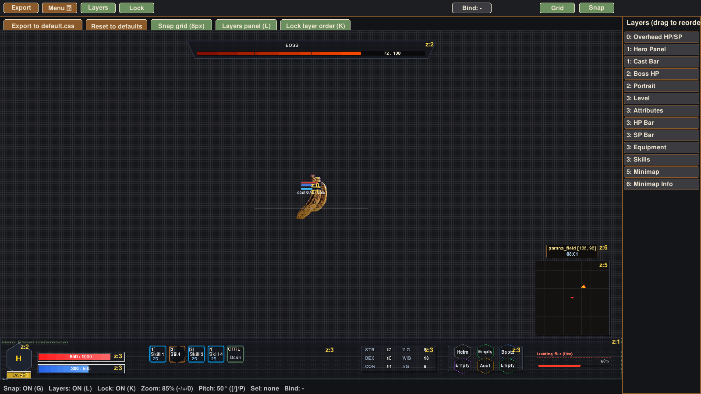

# Caldera

**English** · [Português](README.pt-BR.md) · [日本語](README.ja.md)

Visual interface editor for [Eruption Engine](https://github.com/eruptionlabs/eruption-engine): the engine's own HUD and any interface layout of a game project.

The engine describes its HUD in CSS (`data/hud/default.css`), and a game describes its menus, turn queue and party sheet in CSS files of its own (`<project>/assets/ui/*.css`). Caldera opens any of those files, draws every element exactly where the engine will draw it, and lets you move, resize, create, delete and reorder everything with the mouse. When you export, it writes the CSS back and the engine hot-reloads the interface without a restart.



## Why it matches the game

The preview is not a mockup. Caldera uses the same layout rules as the engine's `CSSLayout` and projects the character with the same camera (60° FOV, the game's starting distance and pitch) and the same billboard as the sprite shader. Widgets attached to the player (`--bind-to-player: 1`) show up exactly where they will appear over the sprite, at any zoom and tilt.

The canvas uses the same scale on X and Y, so the window can have any aspect ratio without stretching the HUD.

## Requirements

- Python 3.10 or newer
- pygame 2.5 or newer (`run.sh` installs it into its own virtual environment)
- A checkout of Eruption Engine

## Running

Inside the engine, where it ships as a submodule:

```bash
git clone --recurse-submodules https://github.com/eruptionlabs/eruption-engine.git
cd eruption-engine
tools/caldera/run.sh
```

Outside the engine, point it at your checkout:

```bash
ERUPTION_ROOT=/path/to/eruption-engine ./run.sh
```

Without `ERUPTION_ROOT`, Caldera walks up from its own folder until it finds the engine's `CMakeLists.txt`.

### Choosing the document

```bash
tools/caldera/run.sh                                     # the engine HUD (data/hud/default.css)
tools/caldera/run.sh --css path/to/menu.css              # any interface .css
tools/caldera/run.sh --project ~/Documents/my-game       # the game project (folder with project.eruption)
```

| Option | What it does |
|---|---|
| `--css FILE` | Opens that `.css`. If it lives inside a project (a parent folder has `project.eruption`), the project is detected on its own. A path that does not exist yet starts an empty document, written only when you export. |
| `--project DIR` | Lists the `.css` files in `DIR/assets/ui/` as tabs and opens the first one (or the one given by `--css`). Images (`--image`) are looked up from `DIR`. |

Tabs switch documents without closing the program, and each tab keeps its unsaved edits (a `*` marks them). **Open** (Ctrl+O) browses for any `.css`; **New .css** (Ctrl+N) starts an empty one. Closing the window with unsaved changes warns once first.

## Elements of an interface

In a game interface every `#id` rule is an element. The type comes from the `--widget` custom property:

| `--widget` | Drawn as |
|---|---|
| `rect` (default) | rectangle with `background-color`, `border-color`, `border-width`, `border-radius` |
| `text` | the `content:` string, with `color`, `font-size` (percent of the screen HEIGHT, or px) and `text-align` |
| `bar` | a track (`background-color`) and a fill (`--fill-color`) with the proportion of `--value` (0 to 1, preview only) |
| `image` | the PNG in `--image: "path"`, relative to the project. If the file is missing, a dashed rectangle with its name |

Without `--widget`, an element is a `rect` (or a `text` when it has `content`). `opacity` is applied; `display: none` is drawn faded, so you can still edit what starts hidden. A `text` without `content` (the script fills it) or without `width`/`height` is marked with a dashed box and its id so it can be selected; dragging it only changes `left`/`top`.

`--parent: #other-id` makes `left`, `top`, `width` and `height` percentages of the parent's rectangle instead of the screen. Dragging a child rewrites its `left`/`top` as a percentage of the parent, and moving the parent moves its children. A `--parent` that points to itself, forms a cycle or names an element that does not exist is ignored and flagged on screen. `--bind-to-player` keeps working as before and ignores the parent.

Text follows the engine's drawing: it starts at the top of the element's rectangle and is aligned inside it. The font is not the engine's, so text widths are an approximation.

## Engine HUD widgets

| Selector | What it is | Positioned relative to |
|---|---|---|
| `#hero-panel` | Bottom panel | screen |
| `#hero-portrait` | Portrait | panel |
| `#hero-level` | Level badge | panel |
| `#hero-hp-bar`, `#hero-sp-bar` | HP and SP bars | panel |
| `#skill-slots`, `#attr-matrix`, `#equip-panel` | Slots filled in by the game | panel |
| `#overhead-hp-sp` | HP and SP above the character | player |
| `#cast-bar` | Cast bar | player or screen |
| `#boss-hp-bar` | Boss bar | screen |
| `#minimap`, `#minimap-info` | Minimap and map name box | screen |

In the engine HUD the widgets above keep their own drawing and, without `--parent`, the ones that say "panel" are children of `#hero-panel`. Positions relative to the screen or the panel are saved as percentages. Widgets attached to the player are saved in pixels from the base of the sprite and scale with the camera zoom.

## Controls

| Action | Input |
|---|---|
| Move a widget | drag (children follow their parent) |
| Resize | drag the handles of the selected widget |
| Nudge | arrow keys (Shift moves 10 px) |
| New element (choose `--widget` and id) | N, or New |
| Duplicate / delete | Ctrl + D / Del (children of a deleted element move up to its parent without moving on screen) |
| Rename the id | F2 (the `--parent` that pointed to it are updated) |
| Edit `content` / `--image` | T |
| Change the parent / the type | R / W |
| Reorder layers (`z-index`) | click a row in the elements panel (sorted by `z-index`, top-most first), drag it, use Up / Down, or Ctrl + PgUp / PgDn |
| Open / new document, next tab | Ctrl + O / Ctrl + N, Tab (Shift + Tab goes back) |
| Reload from disk | F5 (Shift + F5 discards unsaved edits) |
| Shortcut list | F1 |
| Attach to or detach from the player | B |
| Snap to grid | G |
| Layers panel | L |
| Lock layer order | K |
| Save the document (export) | E or Ctrl + S, or the Export button |
| Clear selection | Esc |
| Preview camera zoom | + and −, 0 resets to the game default |
| Camera tilt | [ and ], P resets to 50° |

## Saving without breaking your file

Caldera keeps the file as it was: comments, blank lines, the order of the rules and the formatting of every property you did not touch stay exactly the same. Only the properties that changed are rewritten (in place), new properties go at the end of their rule, and new elements go at the end of the file, formatted like the rest (4 spaces, one property per line). The file is written atomically, and a document that does not exist yet is only created when you export.

## Environment variables

| Variable | Purpose |
|---|---|
| `ERUPTION_ROOT` | Engine folder, when Caldera lives outside it |
| `CALDERA_WINDOW=1600x900` | Initial window size |
| `CALDERA_VIRTUAL=1280x720` | Emulated screen resolution (default 1920x1080) |
| `CALDERA_SCREENSHOT=out.png` | Renders a few frames, saves the image and exits. Handy for comparing against an engine capture |

To compare against the game side by side, capture the engine with its HUD and render Caldera at the same resolution:

```bash
ERUPTION_TEST_SWAP_SHOT=game.png,300 ERUPTION_TEST_EXIT_FRAME=330 ./eruption-engine --project projects/parana_field --map parana_field_lite
CALDERA_VIRTUAL=1280x720 CALDERA_SCREENSHOT=caldera.png tools/caldera/run.sh
```

## Optional images

If they exist in the engine, the preview uses `assets/hud/portrait.png` and `assets/hud/skill_1.png` through `skill_4.png`. Without them the slots are drawn empty. The character sprite comes from `assets/sprites/default.spr` (ERUPTSPR format) or, if that is missing, from `default.png`.

## License

Apache License 2.0, the same as Eruption Engine. pygame is distributed under the LGPL and is installed separately by `run.sh`.

"Eruption Engine" and its logo are trademarks of Gdg Soluções Digitais LTDA.
